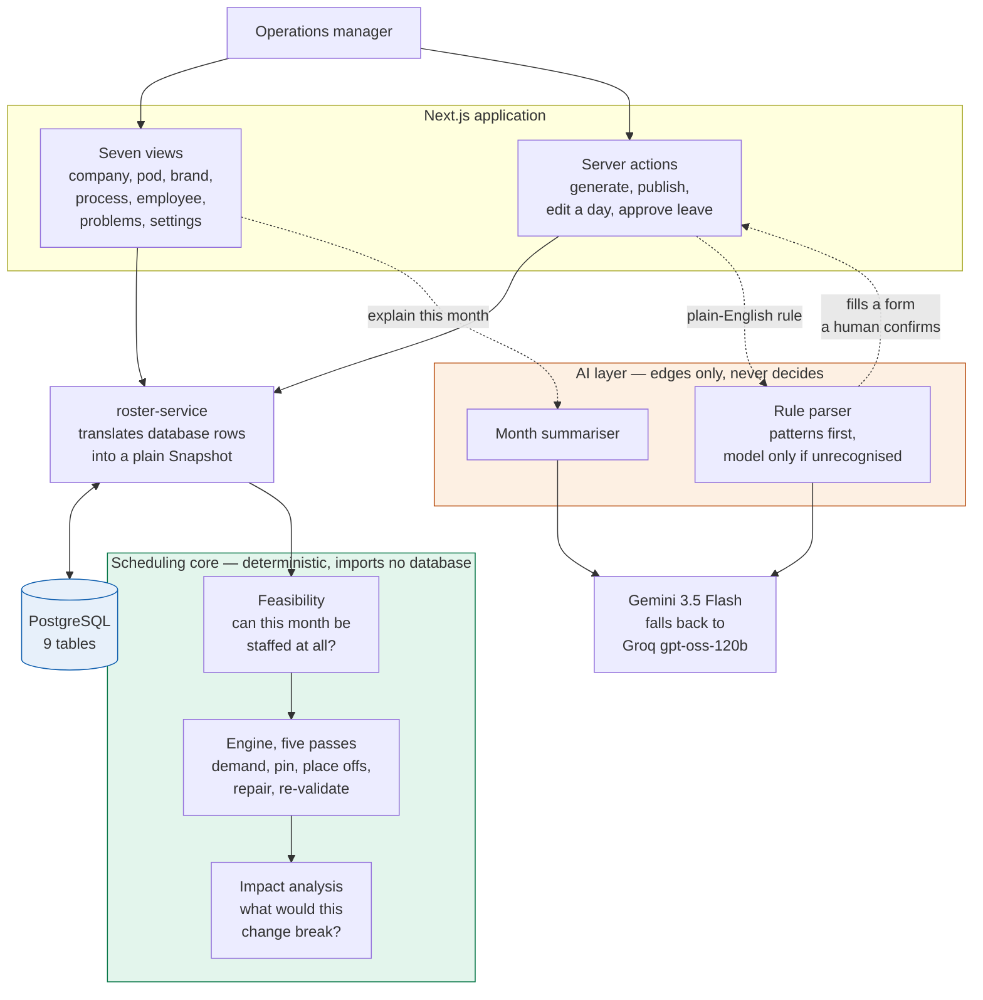
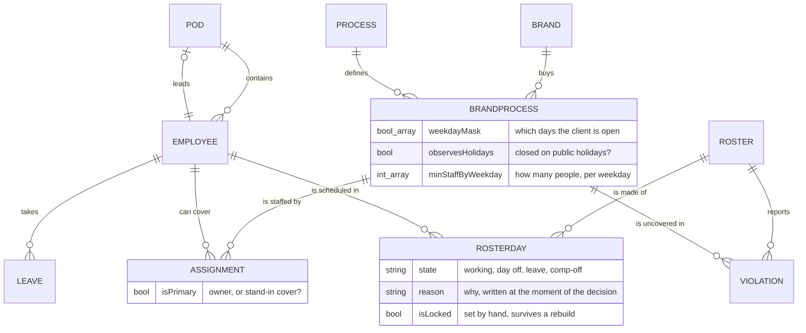

# Smart Roster Management System

Monthly staff rostering across multiple client brands, kinds of work, and pods — with coverage checking that refuses to hide a problem.

Built for the Datastraw Tech AI + Tech internship assessment by **Manasvi Acharya**.

<p align="left">
  
  
  
  
  
  
  
  
  
</p>

- **Live app:** https://manasviacharya-datastrawassignment.onrender.com
- **Repository:** https://github.com/manasviacharya/ManasviAcharya_DatastrawAssignment
- **LinkedIn:** https://www.linkedin.com/in/manasvi-acharya/

> **Note on the free Render tier:** the app sleeps after a period of inactivity, so the very first page load after a quiet spell can take up to a minute to wake up. It is not broken — please give it a moment.

---

## The problem in one paragraph

A customer-experience company runs support operations for ~22 client brands with 32 staff. Each brand buys specific kinds of work — support tickets, abandoned-cart recovery, failed-delivery follow-up, retention — and **each kind of work runs on its own calendar**. Some need somebody on duty all 365 days. Some close on public holidays. Some close Sundays too. Meanwhile every employee is owed a weekly day off and takes leave. About **four in five brands are covered by a single person**, so one day off can leave a client with nobody. The month's roster has to satisfy both sides at once, and when it cannot, it has to say so precisely rather than quietly producing something invalid.

---

## Quick start

```bash
git clone <repo-url> && cd roster-app
npm install
cp .env.example .env          # add your DATABASE_URL
npx prisma migrate deploy     # create the tables
npm run db:seed               # load the sample data
npm run dev                   # http://localhost:3000
```

Requires Node 20+ and a PostgreSQL database.

### Scripts

| Command | What it does |
|---|---|
| `npm run dev` | Development server |
| `npm run build` | Production build |
| `npm test` | 40 unit tests for the scheduling engine |
| `npm run test:ai` | Accuracy of the plain-English rule parser |
| `npm run dry-run` | Run the engine against the sample data with no database |
| `npm run db:seed` | Load sample data (safe to run twice) |

`npm run dry-run` is the fastest way to see the system work — it prints the scorecard, the problems found and a sample person's month, without needing Postgres at all.

---

## Where AI sits, and where it doesn't

**AI at the edges. Ordinary code at the centre.** A roster is a legal and financial document: ask a model *"who should work Sunday?"* and you get a different answer each time, you cannot test it, and you cannot explain it to the person who lost their weekend. Every scheduling decision is therefore made by deterministic code, and a model is used only at the two boundaries.

| Feature | What it does | Why it is safe |
|---|---|---|
| **Rules in plain English** | *"Mon-Sat, closed on public holidays, at least two agents"* becomes a weekday mask, a holiday flag and a minimum headcount | Fills in a form a human confirms. Never writes to the database itself. |
| **Written summary** | Turns a month's problems into a short briefing | Receives decisions already made, plus the reasons the engine recorded. Summarises; never chooses. |

**Measured, not asserted.** `npm run test:ai` scores the parser against 20 hand-written cases, each with a known answer. The deterministic path gets **15/20 with zero wrong answers and five clean abstentions**; with a model it reaches **19/20**. Zero-wrong is the number worth defending — the rules either get it right or decline, so a misread never arrives looking as confident as a correct answer.

**One AI feature I refused.** Embeddings to find backup staff by similarity. Whether somebody can cover a service is a fact in the `Assignment` table, not a resemblance, and replacing a correct lookup with a probably-right one is the wrong direction for a tool a manager relies on.

Requests try Gemini, then Groq, so one provider being slow or down does not take the features with it. **The app is fully functional with no API keys at all** — the parser falls back to its deterministic path and the summary hides itself.

---

## Architecture



Three things this diagram is drawn to show.

**The scheduling core imports no database.** It takes a plain `Snapshot` object and returns a plain result, which is why it can be tested with no Postgres at all (`npm run dry-run`) and why the same input always gives the same output.

**The AI layer only touches the edges.** It reads rules written in plain English on the way in, and writes summaries on the way out. No arrow runs from the AI layer into the scheduling core, because none exists — the roster is byte-identical whether a model is configured or not.

**The rule parser loops back through a human.** It fills in a form; a person confirms it; the server action writes. There is no path from a model straight to the database.

## The scheduling logic, in detail

Answer 2 below walks through the five passes. This is the part that does not fit there.

### The cost function

Pass 3 scores all seven candidate days off for each person each week and takes the cheapest.

```
score(employee, day) =
    1000 × lines of work left below minimum    ← hard constraint
  +   50 × (not their preferred day off)       ← soft
  +   20 × days of excess consecutive working  ← soft
  +    1 × colleagues already off that day     ← fairness tiebreak
```

The weights carry the brief's hard-versus-soft distinction. 1000 is large enough that no stack of preferences can outvote a client commitment.

**Two of these were wrong until I measured them.** `CROWDED_DAY` started at 10, which with 32 employees reached ~320 and silently outranked the preference weight of 50 — people were losing their Sunday simply because colleagues had taken it. Dropping it to 1 moved preference-kept from **18.8% to 37.2%** and fairness from **1.37 to 0.81**.

### Feasibility runs per person as well as per client

The per-client check is obvious: one person on a 365-day brand cannot work 31 days. The second check catches what it cannot see.

Someone owning one client open Mon–Sat and another open Sundays passes *every* per-client test — 26 days needed against 26 available, and 4 against 26 — while the combination demands all seven days a week from one person. Without it the app reports four uncovered days blaming *"Pooja is on her weekly off"*, which is the symptom, and never says no schedule could have worked. This is also the brief's *"employee assigned to overlapping responsibilities"*. The second check stays quiet where the first has already spoken, so one fact is reported once at the right level.

### A working day covers everything that person owns

Being on shift is not consumed by one client. Someone covering two small brands serves both the same day, so their availability counts in full against each assignment rather than being divided. Dividing it would invent shortfalls that do not exist.

### Every cell records why

Written at the moment of the decision — *"Weekly off moved to Sunday. Preferred Wednesday off was not possible because Vireo Living / CS would have had nobody on duty."* It costs almost nothing and pays off three times: the employee view documents itself, the problem list cites its own evidence, and the AI summariser is handed sentences the engine already wrote rather than guessing at a grid of coloured squares.

---

## The scorecard

Four numbers per roster, because "it generated something" is not a quality claim:

| Metric | Meaning |
|---|---|
| **Coverage** | Client-days satisfied ÷ client-days required |
| **Preferred day off kept** | Share of employee-weeks where the preference held |
| **Fairness spread** | Standard deviation of Sundays off. Lower is more even |
| **Staffing shortfall** | Person-days nobody could possibly work |

On the sample data: **99.2% coverage, 992 cells generated in 34 ms**, one staffing shortfall — the deliberately unstaffable brand.

---

## Sample data

32 employees · 6 pods · 22 brands · 36 lines of work · 69 assignments · 22 leave days.

**18 of 22 brands are owned by a single person (82%)**, matching the brief's ~80%. Pod leads are modelled as *backup cover* rather than owners, so that figure counts owners only.

Four cases are planted deliberately:

| Brand | What it demonstrates |
|---|---|
| **Vireo Living** | **Impossible.** One person, 365-day support. Caught by the feasibility check before scheduling starts. |
| **Harlow & Co** | **Fixable.** Two people on 365-day cover; one takes leave and the other absorbs it. |
| **Northwind Supply** | **Nothing breaks.** Three people, minimum two; one away and the minimum still holds. |
| **Castellan Leather** | **Two calendars, one client.** Support runs 7 days; cart recovery runs weekdays only. |
| **Northwind Supply** | **A minimum that varies by weekday.** Two people daily, three on Mondays. |

The third matters as much as the first: an app that warns about everything is as useless as one that warns about nothing.

---

## Assumptions

The brief leaves some things unstated. I assumed, and made each configurable:

1. **A day is one shift.** Shift-level granularity is the biggest simplification in the model — see Q8.
2. **One weekly off per employee per calendar week.** Configurable per person.
3. **Pod leads provide backup cover rather than owning brands.** Without this, a brand owned by one person and open six days a week has *zero* slack in a five-week month, and a single day of leave leaves the client uncovered.
4. **A working day covers all of that person's assignments at once** (see capacity note above).
5. **Partial weeks at month boundaries still earn a day off**, but a stub of 1–2 days is not *required* to contain one.
6. **Holiday dates are illustrative sample data**, not an authoritative calendar. Fully editable in the app.

---

## Technology & Tech Stack

- **Framework & Core:** **Next.js 15** (App Router, Server Actions, React Server Components) & **React 19**
- **Language:** **TypeScript 5** (Strict mode, pure deterministic scheduling functions)
- **Database & ORM:** **PostgreSQL** via **Prisma ORM 6** (declarative migrations, transactions, indexed lookups)
- **Styling & UI:** **Tailwind CSS**, hand-crafted responsive components (server-rendered grid shipping only ~190 B JS)
- **AI & LLM Layer:** **Google Gemini 3.5 Flash** with automatic fallback to **Groq (`gpt-oss-120b`)** for edge parsing and briefings
- **Testing & Tooling:** Node.js native test runner via `tsx` (40 unit tests, 20 AI evaluation benchmarks, zero-DB dry-run)
- **Cloud & Deployment:** **Render** (Unified Web Service + Managed PostgreSQL configured via `render.yaml`)

| Layer | Choice |
|---|---|
| Framework | Next.js 15 (App Router), React 19 |
| Language | TypeScript, strict |
| Database | PostgreSQL via Prisma |
| Styling | Tailwind CSS, hand-written components |
| AI | Gemini 3.5 Flash, falling back to Groq `gpt-oss-120b`. Both optional |
| Hosting | Render |

Grid pages ship **~190 B of JavaScript** each. A 32 × 31 grid is 992 cells, and making each an interactive client component would ship a great deal of JavaScript to reimplement the `title` attribute.

> **Known advisory:** `npm audit` reports transitive advisories inside Next's and Prisma's own dependency trees (`postcss`, `deepmerge-ts`). These are build-time dependencies with no non-breaking fix available at the pinned versions.

---

## Deployment

A `render.yaml` blueprint creates both the web service and the database from a clone.

```
Build:  npm ci && npx prisma generate && npx prisma migrate deploy && npm run build
Start:  npm start
Health: /api/health
```

`prisma migrate deploy` runs as part of the **build**, so the schema travels with the deploy — no manual migration step, and no window where the running code expects a column the database doesn't have.

Then seed once from the Render shell: `npm run db:seed` (idempotent — a second run changes nothing).

---

# Tell us how you think

### 1. How did you model employees, brands, processes, pods and their relationships?



I kept **demand** and **supply** in separate tables.

`BrandProcess` is the demand row — one per kind of work a client buys. It owns the operating calendar and the minimum headcount, because **operating rules belong to a line of work, not to a client**. Castellan Leather runs support 7 days a week and cart recovery on weekdays only; if the calendar lived on `Brand`, that would be inexpressible, and the brief asks for it specifically.

`Assignment` is the supply row — many-to-many, so one person can cover several brands and one line of work can have several people. `isPrimary` separates owners from backups.

The calendar itself is **seven booleans plus a holiday flag**, not an enum of the three patterns the brief names. A fourth pattern is then data, not a code change — which is what makes the "no code changes" requirement actually true.

The **minimum headcount is a per-weekday array** alongside it, for the same reason. The brief asks for "minimum staffing requirements on specific days", and a single number per service cannot say *"three people on Mondays to clear the weekend backlog, two the rest of the week"* — which Northwind Supply in the sample data does. Storing seven values instead of one also made the feasibility arithmetic better: demand is now summed per operating day rather than multiplied by a single figure.

Pods are a reporting overlay that doubles as the first ring of the backup search.

### 2. How does your system generate a roster and check it satisfies the constraints?

A manager picks a month and presses one button. What happens then is deliberately boring and repeatable — plain TypeScript, no solver, identical output for identical input.

**Step 0 asks whether the month is possible at all**, before anything is scheduled. Two questions: does each client have enough person-days across the people assigned to it, and does each *person* have enough days for everything only they can cover? Either can fail while the other looks fine.

**Then five passes:**

| | | |
|---|---|---|
| 1 | Build the demand matrix | how many people each client needs, per day |
| 2 | Pin what cannot move | approved leave, and any day a manager locked by hand |
| 3 | Place weekly offs by cost | the heart of it — score all seven candidate days, take the cheapest |
| 4 | Repair | move a day off within the same week to close a gap, if that helps |
| 5 | Re-validate from scratch | check every rule against the finished grid |

**Pass 5 is the part I would defend hardest.** I don't assume the roster is valid because of how I built it — it is easy to write logic that *should* produce something correct. Every rule is re-checked against the finished artefact, and each failure is saved as a `Violation` row rather than printed to a console. That is what makes problems filterable in the UI, linkable to the cell that caused them, and feedable to the summariser as evidence rather than guesswork.

Correctness is also asserted in tests rather than asserted in prose: 40 of them, covering every planted case, the hard-beats-soft ordering, determinism across repeated runs, and that a manually edited day survives a rebuild.

### 3. How did you handle single-resource brands versus brands with multiple employees?

The engine doesn't treat them differently at all — the difference falls out of available person-days. What *does* differ is the **diagnosis**:

- **One person:** a gap is usually arithmetic, caught by the feasibility check before scheduling starts, and reported as *"no schedule can fix this."*
- **Several people:** a gap is usually bad allocation, so the repair pass attempts it, and if it can't, the report names a specific backup.

### 4. What happens when an employee manages all processes for a brand but is unavailable on a required working day?

The day is flagged uncovered, attributed to the specific brand and kind of work, and the backup search widens past the brand to anyone trained on the same kind of work elsewhere. Real output from the sample data:

> **Vireo Living / CS needs 1 on duty but has 0.** Unavailable: Faisal Khan (on leave).
> → *Arjun Pillai already works Customer Support for another brand, and is working on this date. Assigning them to Vireo Living / CS would close this gap.*

If nobody qualifies, it says the gap is unavoidable with current staffing and quantifies the shortfall. It never silently reassigns the work or quietly drops the requirement.

### 5. How does your system handle conflicting requirements or insufficient staffing?

Every rule is typed **must-hold** or **wish**, and the must-hold weight is large enough that no pile of preferences can outvote a client commitment. A client's contracted day beats someone's preferred Sunday — but it does **not** beat their right to a day off somewhere that week. If the only way to cover a brand is to work someone seven straight days, that is not a scheduling problem; it is a staffing shortage, and the app says so.

Insufficient staffing is caught separately, *before* scheduling, by comparing person-days demanded against person-days available:

> **Vireo Living / CS cannot be staffed this month.** It needs 31 person-days across 31 operating days, but the one person assigned (Faisal Khan) can supply at most 25. Short by 6 person-days.
> → *One person cannot cover 31 days in a month while taking a weekly off. Assign at least 1 more person, or change the operating calendar. **No schedule can fix this.***

The same check runs per person as well as per client, because an employee can be over-committed across clients that each look adequately staffed alone.

That distinction — *I scheduled badly* versus *this cannot be scheduled* — is the most useful thing in the system, because the two need completely different decisions.

### 6. Which parts did you automate, and which did you leave under human control? Why?

**Automated:** calendar arithmetic, placing days off, coverage checking, conflict detection, backup suggestion, and prose summarisation.

**Human:** approving leave, accepting a broken preference, choosing between suggested fixes, and publishing.

I split it by consequence. The computer is good at counting combinations; it has no business deciding whose weekend gets taken. So it proposes and the manager disposes — the impact check computes the effect of a leave request but saves nothing until a person approves it, and approving is allowed *even when it leaves a client uncovered*, because the app's job is to make the consequence visible, not to overrule the manager.

Note where the AI sits in that list: it reads rules and writes summaries. It never picks a day off.

### 7. If the company doubled its team and brand count, what would you change?

The data model holds as-is. The weak point is pass 4 (repair), which degrades quadratically. My first move would be to **generate each pod's schedule separately** — pods barely overlap, so one big problem becomes six small ones that can run in parallel.

I'd also move generation to a background job polled by the UI, since the current synchronous path would eventually hit a request timeout.

If cross-pod sharing grew enough to break partitioning, I'd keep this engine as the explainable baseline and add an optimisation library behind the same interface — then compare the two against the four scorecard numbers rather than simply trusting the newer one.

### 8. If you had one more week, what would you improve first?

**Shift-level granularity.** Treating a day as one block is the biggest simplification in the model, and real support teams run morning and evening shifts. It would change the demand matrix from days to slots and make coverage meaningfully more accurate.

After that: **saving multiple versions of a roster side by side**, so a manager can weigh two options against the scorecard instead of accepting one. The scorecard already makes that comparison meaningful — it just needs somewhere to put the second plan.

---

## Project layout

```
prisma/
  schema.prisma         9 tables, heavily commented — the data model answer
  seed-data.ts          sample data with the four planted cases
src/lib/scheduler/      the engine — no database imports, pure functions
  engine.ts             the five passes and the cost function
  feasibility.ts        can this month be staffed at all?
  calendar.ts           date handling, all strings
src/lib/ai/
  rule-rules.ts         deterministic parser (15/15 on its own)
  rule-parser.ts        rules first, Gemini fallback
  explain.ts            month summariser
src/lib/impact.ts       what a leave request would break
src/app/                views, admin, server actions
scripts/dry-run.ts      run the engine with no database
```
